<div align="right">

*[中文版](README.zh-CN.md)*

</div>

<div align="center">


# **SUZENT: THE SOVEREIGN AI AGENT**

### **Your agent should not be an account you rent.**

An open-source, local-first personal AI agent whose memory, authority, runtime, and continuity stay yours.

A memory it curates in files you own · 16 model providers, cloud or your own hardware · actions reviewed against your rules · Regent keeps every project moving while you're away · desktop, phone, editor, and the chat apps you already use

[](https://github.com/cyzus/suzent/releases) [](https://github.com/cyzus/suzent/stargazers) [](LICENSE) [](https://python.org) [](https://discord.gg/MkBDDbwPBK)

**[Website](https://suzent.com)** • **[Quickstart](docs/01-getting-started/quickstart.md)** • **[Docs](docs/README.md)** • **[Discord](https://discord.gg/MkBDDbwPBK)** • **[Contributing](./CONTRIBUTING.md)**



</div>

---

##  **MEET SUZENT**

**SUZENT** [soo-zuh-nt] keeps an agent's identity, memory, skills, workspace, and runtime under your control. Use GPT, Claude, Gemini, DeepSeek, Qwen, a model on your own GPU, or whatever comes next, without resetting the agent that knows you and your work.

It is not a chat window. It remembers what you told it and what it learned, tidies that memory overnight, works through goals and schedules while you're away, and asks before it does anything you haven't allowed. Its memory is plain files on your disk, its actions pass through permission modes you set, and its code runs in an isolated Docker sandbox or on the host under path restrictions you choose.

**Models are replaceable. Platforms are temporary. Your agent remains.**

---

## **QUICK START**

SUZENT runs on Windows, macOS, and Linux. Git is the only prerequisite; everything else is installed for you.

**macOS / Linux**
```bash
curl -fsSL https://raw.githubusercontent.com/cyzus/suzent/main/scripts/setup.sh | bash
```

**Windows** (PowerShell)
```powershell
powershell -NoProfile -ExecutionPolicy Bypass -Command "irm https://raw.githubusercontent.com/cyzus/suzent/main/scripts/setup.ps1 | iex"
```

Then start it and add a model under **Settings → Providers**:

```bash
suzent start
```

No API key? Pick [Ollama](docs/04-models/local/ollama.md) and run everything on your own machine.

<details>
<summary><b>Installing from mainland China</b></summary>

Nothing to configure. Setup checks the network first: when Google is unreachable but the mainland mirrors answer, it downloads Suzent itself (from its Gitee mirror), Python, Python packages, the Playwright browser and uv from mainland mirrors. The Windows desktop installer also shows a "use mainland mirrors" switch, and updates keep whatever you chose.

If `raw.githubusercontent.com` does not load, fetch the same script from jsDelivr:

```bash
curl -fsSL https://cdn.jsdelivr.net/gh/cyzus/suzent@main/scripts/setup.sh | bash
```

```powershell
powershell -NoProfile -ExecutionPolicy Bypass -Command "irm https://cdn.jsdelivr.net/gh/cyzus/suzent@main/scripts/setup.ps1 | iex"
```

To force mirror mode on or off, set `SUZENT_CHINA_MIRROR=1` or `SUZENT_CHINA_MIRROR=0` before running setup. If GitHub itself is slow, set `SUZENT_REPO_URL` or `SUZENT_RELEASE_BASE_URL` to a mirror you trust.

On a mainland network, **Settings → Model Providers** lists DeepSeek, Qwen (DashScope), Kimi, Zhipu GLM and the other providers reachable without a VPN first, each with a link to get an API key.

</details>

<details>
<summary><b>The <code>suzent</code> CLI</b></summary>

```bash
suzent --version       # Print the backend version, commit, and UI version
suzent start           # Start the backend and the desktop app (in the background)
suzent serve           # Start the backend only (headless / standalone)
suzent web             # Open the web console against the backend
suzent ui              # Start the desktop app against a running backend
suzent logs -f         # Follow the log of a backgrounded process
suzent stop            # Stop the backend server and the dev frontend
suzent restart         # Stop a running backend server, then start Suzent again
suzent doctor          # Check requirements and diagnose a broken install
suzent update          # Update to the latest stable release
suzent check-update    # Report whether a newer release exists
suzent repair          # Recover an interrupted or damaged update
```

Run `suzent --help`, or `suzent <command> --help`, for the full flag set.

</details>

<details>
<summary><b>Updating</b></summary>

```bash
suzent update
```

This installs the latest stable release as one matched set: backend source, locked dependencies, and desktop app. A standalone updater performs the switch outside the active virtual environment, verifies downloaded assets, and rolls back automatically on failure. If an interrupted update needs recovery, run `suzent repair`.

Developers working from a source checkout can update `main` and its frontend dependencies together with plain `suzent update`; the checkout is detected automatically. The explicit equivalent is `suzent update --dev`.

Or re-run the install command above — it detects an existing installation and updates it to the latest stable release.

</details>

---

## **WHAT MAKES AN AGENT SOVEREIGN?**

Sovereignty is not merely local execution. It is ownership of the agent's **mind, authority, vessel, and continuity**.

<div align="center">

</div>

| Question | SUZENT's answer |
|---|---|
| Who owns its memory? | **You.** Plain files on your disk are the source of truth. |
| Who chooses its intelligence? | **You.** Sixteen providers built in, and any compatible endpoint you add. |
| Who defines what it may do? | **You.** Permission modes, rules, and sandbox boundaries are explicit. |
| Where does it live? | **On infrastructure you control.** |
| Can it move? | Memory, skills, and configuration are portable; credentials stay local. |
| Can you inspect it? | Tool calls, authorization decisions, files, and memory remain visible. |

---

##  **CHOOSE ITS INTELLIGENCE**

Models are engines, not identities. Add as many providers as you like, pick a model per conversation, and switch without losing the memory, skills, or workspace that make the agent yours.

| | Providers |
|---|---|
| **Frontier labs** | [OpenAI](docs/04-models/cloud/openai.md) (also Azure OpenAI) · [ChatGPT Subscription](docs/04-models/cloud/chatgpt-subscription.md) (sign in with your ChatGPT plan, no API key) · [Anthropic Claude](docs/04-models/cloud/anthropic.md) · [Google Gemini](docs/04-models/cloud/gemini.md) · [xAI Grok](docs/04-models/cloud/xai.md) |
| **Open-weight labs** | [DeepSeek](docs/04-models/cloud/deepseek.md) · [Qwen (DashScope)](docs/04-models/cloud/dashscope.md) · [Kimi (Moonshot)](docs/04-models/cloud/moonshot.md) · [GLM (Zhipu AI)](docs/04-models/cloud/zhipu.md) · [MiniMax](docs/04-models/cloud/minimax.md) · [Xiaomi MiMo](docs/04-models/cloud/xiaomi-mimo.md) |
| **Gateways** | [OpenRouter](docs/04-models/cloud/openrouter.md) (hundreds of models, one key) · [LiteLLM Proxy](docs/04-models/local/litellm.md) |
| **Your own hardware** | [Ollama](docs/04-models/local/ollama.md) · [vLLM](docs/04-models/local/vllm.md) · [SGLang](docs/04-models/local/sglang.md) |
| **Anything else** | Add a custom provider for any OpenAI-compatible endpoint, or a custom model ID on any card above. |

Keys live in your operating system's keychain, never in plain-text config. [Model roles](docs/04-models/model-roles.md) let a small, cheap model handle titles, memory extraction, and permission review while your best model holds the conversation, and every role can carry backup models that take over when the first one fails.

---

##  **OWN ITS MEMORY**

Memory is where a sovereign agent keeps its self, so Suzent treats it as a curated knowledge base, not a chat log.

<div align="center">

</div>

- **It captures with evidence.** Every few exchanges, facts are extracted and typed (a preference, a project detail, a lesson), each with the exact words it came from. A fact about you is kept only when you said it yourself, never when the agent guessed it.
- **It learns from what went wrong.** When a command fails or you correct the agent, and the same exchanges show the fix, it saves what to do next time and where it applies. A lesson that keeps recurring for a repository is offered as a change to that repository's agent instructions.
- **It tidies overnight.** An organizer reads the new daily logs and, for each fact, confirms, sharpens, supersedes, or adds it on a topic page. Contradictions become questions for you instead of guesses, and the old value is kept under a History heading.
- **It keeps a notebook.** One page per topic, in a folder of plain notes the agent also researches and writes into (it opens as an Obsidian vault if you use Obsidian). A short map of those pages is loaded into every chat.
- **It recalls with hybrid search.** Meaning, keywords, recency, and importance are scored together, so a fact you repeat often ranks above one you mentioned once.
- **It forgets gently.** Each fact gets a review date by kind (a year for preferences, three weeks for passing context). Expired facts fade in search; nothing is deleted behind your back.

All of it is plain text files (Markdown) on your disk: open them in any editor, change them, keep them in Git. The LanceDB search index is rebuilt from those files at any time. [How memory works →](docs/03-features/memory/README.md)

---

##  **GOVERN ITS ACTIONS**

Autonomy never makes the agent the authority. Each conversation runs in one of three modes:

| Mode | What happens |
|---|---|
| **Ask** (default) | Read-only actions run. Anything that changes files or the outside world asks you first. |
| **Smart** | Clearly low-risk actions run on their own. Everything else goes to a separate reviewer model, which approves it, blocks it, or asks you. |
| **Full Access** | Actions run without asking. |

Your deny rules, blocked paths, and dangerous-command checks apply in every mode. An optional Docker sandbox isolates execution, and the activity timeline records what ran, what changed, and why it was authorized. [Permissions & approvals →](docs/03-features/tools/human-in-the-loop.md)

---

##  **LET IT WORK WHILE YOU'RE AWAY**

You are the sovereign; **Regent** governs in your stead. It is the one conversation at the top of the sidebar that watches every project: tell it what you want done, and it hands the work to a session in the right project, or to a coding agent such as Codex or Claude Code, then follows up while you're gone.

<div align="center">

</div>

- **One place to look.** Its board shows which chats are waiting on you, which are running, and a one-line note on where each stands.
- **It only brings you decisions.** When a session finishes with nothing for you to do, Regent notes it quietly. Work that is blocked on you always notifies you.
- **It checks in on its own.** Every 30 minutes it looks for stalled work and unanswered questions, and nudges things along.
- **It remembers how you like to work**: what to bring to you, what to handle itself, and when not to disturb you.

Any chat can also run on a timetable ("every weekday at 9, summarize my inbox", or a reminder next Friday), and every chat turn saves a checkpoint first, so a retry restores both the conversation and the files. Extend it with portable `SKILL.md` packages and any MCP server you connect. [Regent →](docs/02-using/regent.md) · [Scheduled tasks →](docs/03-features/automation.md)

---

##  **KEEP ITS CONTINUITY**

GitHub Sync carries portable configuration, user skills, and Markdown memory through a private repository while credentials remain device-local. A provider can disappear, a model can change, and a machine can be replaced without taking the agent's continuity with it.

---

## **WHERE YOU TALK TO IT**

<div align="center">

</div>

One agent, one memory, reachable from every surface. Messaging channels are off by default and access-controlled: a user ID must appear in `allowed_users` before the agent will answer it.

| Surface | Transport | Supports | Setup |
|---|---|---|---|
| **Desktop app** | Local backend | Full UI, Canvas, memory and skills browsers | `suzent start` |
| **Web console** | Local backend | The same UI in your browser | `suzent web` |
| **Mobile app** (preview) | Paired with your desktop | Shared conversations | [Guide](docs/03-features/nodes.md#pair-your-phone) |
| **Your editor** | ACP | Use Suzent as the agent in Zed and other ACP clients | [Guide](docs/03-features/nodes.md#use-suzent-from-your-editor-acp) |
| **Other agents** | A2A | Delegate work to other agents, or take work you grant them | [Guide](docs/03-features/nodes.md#work-with-other-agents-a2a) |
| **Telegram** | Bot API | Text, photos, files | [Guide](docs/05-chat-apps/telegram.md) |
| **Slack** | Socket Mode (Events API) | Text, files | [Guide](docs/05-chat-apps/slack.md) |
| **Discord** | Gateway | Text, files | [Guide](docs/05-chat-apps/discord.md) |
| **Feishu (Lark)** | WebSocket | Text, files | [Guide](docs/05-chat-apps/feishu.md) |
| **WeChat** | iLink Bot API | Text | [Guide](docs/05-chat-apps/wechat.md) |

Each conversation becomes a persistent session, so history, working memory, and extracted facts survive a restart.

---

## **DOCUMENTATION**

| Section | What's covered |
|---|---|
| [What is Suzent?](docs/01-getting-started/intro.md) | What a sovereign agent is and what Suzent can do |
| [Quickstart](docs/01-getting-started/quickstart.md) | Install, connect a model, and start chatting |
| [Regent](docs/02-using/regent.md) | The one chat that watches every project and follows up while you're away |
| [Models & Providers](docs/04-models/README.md) | All 16 providers, custom endpoints, and model roles |
| [Memory](docs/03-features/memory/README.md) | What the agent remembers, where it lives, and how to edit it |
| [Notebook](docs/03-features/memory/llm-wiki.md) | Agent-maintained, Obsidian-compatible knowledge vault |
| [Tools](docs/03-features/tools/README.md) | Everything the agent can do, and how to turn it on or off |
| [Permissions & approvals](docs/03-features/tools/human-in-the-loop.md) | How Suzent asks before it acts |
| [Skills](docs/03-features/skills.md) | Install, write, and manage portable `SKILL.md` packages |
| [Workspace & sandbox](docs/03-features/filesystem.md) | Folders, the Docker sandbox, and undoing a turn |
| [Automation](docs/03-features/automation.md) | Scheduled tasks, heartbeats, goals, and the background service |
| [Chat apps](docs/05-chat-apps/README.md) | Telegram, Slack, Discord, Feishu, WeChat |
| [Devices & other agents](docs/03-features/nodes.md) | Your phone, other computers, A2A agents, and your editor |
| [GitHub Sync](docs/03-features/github-sync.md) | Carry your agent to another computer through a private repo |
| [Development Guide](docs/08-developing/contributing/development-guide.md) | Setup, workflow, builds, architecture |
| [Native Mobile](docs/08-developing/architecture/mobile.md) | SwiftUI/Compose developer preview, monorepo layout, and roadmap |

The full index lives in [docs/README.md](docs/README.md).

---

## **TECH STACK**

*   **BACKEND**: Python 3.12, FastAPI, pydantic-ai, litellm, SQLite.
*   **FRONTEND**: React, TypeScript, Tailwind, Vite, Tauri.
*   **MEMORY**: Markdown files as the source of truth, LanceDB hybrid (vector + full-text) index.
*   **SANDBOX**: Docker (optional).
*   **EXTENSIBILITY**: MCP, portable `SKILL.md` packages.

---

## **CONTRIBUTING**

Contributions welcome. See [CONTRIBUTING.md](./CONTRIBUTING.md) for the workflow, and the [Development Guide](docs/08-developing/contributing/development-guide.md) for setup, production builds, and architecture.

---

## **SECURITY**

Found a vulnerability? Please report it privately—see [SECURITY.md](SECURITY.md). Do not open a public issue.

---

## **LICENSE**

**[APACHE 2.0](LICENSE)** © 2026 Yizhou Chi.

**SUMMON LOCALLY. REMEMBER PRIVATELY. ANSWER TO NO FALSE GOD.**
