<div align="right">

*[English](README.md)*

</div>

<div align="center">


# **SUZENT：主权 AI 智能体**

### **你的智能体不应是一个租来的账号。**

一个开源、本地优先的个人 AI 智能体，它的记忆、权限、运行环境与连续性始终属于你。

记忆由它自己整理，存在你拥有的文件里 · 16 家模型提供商，云端或你自己的硬件 · 每个行动都按你的规则审查 · 你不在时由 Regent 推进每个项目 · 桌面、手机、编辑器，以及你已经在用的聊天应用

[](https://github.com/cyzus/suzent/releases) [](https://github.com/cyzus/suzent/stargazers) [](LICENSE) [](https://python.org) [](https://discord.gg/MkBDDbwPBK)

**[官方网站](https://suzent.com/zh-Hans/)** • **[快速开始](docs/01-getting-started/quickstart.md)** • **[文档](docs/README.md)** • **[Discord](https://discord.gg/MkBDDbwPBK)** • **[贡献指南](./CONTRIBUTING.md)**



</div>

---

##  **认识 SUZENT**

**SUZENT** [soo-zuh-nt] 让智能体的身份、记忆、技能、工作区和运行环境始终处于你的控制之下。你可以使用 GPT、Claude、Gemini、DeepSeek、通义千问、跑在你自己 GPU 上的模型，以及未来出现的任何模型，而无需重置那个了解你和你的工作的智能体。

它不只是一个聊天窗口。它记得你告诉过它的事和它自己学到的经验，每晚整理这些记忆，在你不在时持续推进各个项目，做你没有允许的事之前会先问你。它的记忆是你磁盘上的普通文件，它的行动要经过你设定的权限模式，它的代码运行在隔离的 Docker 沙盒中，或在你设定路径限制的主机上运行。

**模型可以替换，平台终会更迭，而你的智能体始终属于你。**

---

## **快速开始**

SUZENT 可运行在 Windows、macOS 和 Linux 上。Git 是唯一的前置条件，其他一切都会自动安装。

**macOS / Linux**
```bash
curl -fsSL https://raw.githubusercontent.com/cyzus/suzent/main/scripts/setup.sh | bash
```

**Windows**（PowerShell）
```powershell
powershell -NoProfile -ExecutionPolicy Bypass -Command "irm https://raw.githubusercontent.com/cyzus/suzent/main/scripts/setup.ps1 | iex"
```

然后启动它，并在 **设置 → 模型提供商** 中添加模型：

```bash
suzent start
```

没有 API 密钥？选择 [Ollama](docs/04-models/local/ollama.md)，一切都在你自己的机器上运行。

<details>
<summary><b>在中国大陆安装</b></summary>

不需要额外设置。安装程序会先测一下网络：连不上 Google、但能连上国内镜像时，就自动改用国内源下载 Suzent 代码（Gitee 镜像）、Python、依赖包、浏览器内核和 uv。Windows 桌面安装器里也有“使用国内镜像加速”开关，可以手动打开或关闭，之后的更新会沿用这个选择。

如果 `raw.githubusercontent.com` 打不开，可以从 jsDelivr 获取同一个脚本：

```bash
curl -fsSL https://cdn.jsdelivr.net/gh/cyzus/suzent@main/scripts/setup.sh | bash
```

```powershell
powershell -NoProfile -ExecutionPolicy Bypass -Command "irm https://cdn.jsdelivr.net/gh/cyzus/suzent@main/scripts/setup.ps1 | iex"
```

想强制开启或关闭镜像，在运行前设置 `SUZENT_CHINA_MIRROR=1` 或 `SUZENT_CHINA_MIRROR=0`。如果 GitHub 本身访问较慢，可把 `SUZENT_REPO_URL` 或 `SUZENT_RELEASE_BASE_URL` 设置为你信任的镜像地址。

装好以后，**设置 → 模型提供商** 会把 DeepSeek、通义千问（DashScope）、Kimi、智谱 GLM 等国内可直连的服务商排在最前面，每一家都有申请 API 密钥的链接。

</details>

<details>
<summary><b><code>suzent</code> 命令行</b></summary>

```bash
suzent --version       # 打印后端版本号、提交哈希与桌面应用版本
suzent start           # 在后台启动后端与桌面应用
suzent serve           # 仅启动后端（无界面 / 独立模式）
suzent web             # 在浏览器中打开连接后端的网页控制台
suzent ui              # 连接已运行的后端，仅启动桌面应用
suzent logs -f         # 实时查看后台进程的日志
suzent stop            # 停止后端服务与开发前端
suzent restart         # 停止正在运行的后端服务，然后重新启动 Suzent
suzent doctor          # 检查依赖环境，诊断安装问题
suzent update          # 更新到最新稳定版
suzent check-update    # 查看是否有新版本可用
suzent repair          # 修复中断或损坏的更新
```

运行 `suzent --help` 或 `suzent <命令> --help` 查看完整参数。

</details>

<details>
<summary><b>更新</b></summary>

```bash
suzent update
```

该命令会将最新稳定版作为一个匹配的整体安装：后端源码、锁定的依赖和桌面应用。独立更新器会在当前虚拟环境之外执行切换，校验下载的文件，并在失败时自动回滚。如果更新被中断需要恢复，请运行 `suzent repair`。

从源码检出进行开发的用户，直接运行 `suzent update` 即可同时更新 `main` 分支及其前端依赖——检出目录会被自动识别。等价的显式写法是 `suzent update --dev`。

或重新运行上面的安装命令——它会检测现有安装并更新到最新稳定版。

</details>

---

## **什么才是主权智能体？**

主权并不只是本地运行，而是对智能体的**心智、权力、容器与连续性**的完整所有权。

<div align="center">

</div>

| 问题 | SUZENT 的回答 |
|---|---|
| 谁拥有它的记忆？ | **你。** 你磁盘上的普通文件就是唯一可信来源。 |
| 谁选择它的智能？ | **你。** 内置 16 家提供商，还能接入任何兼容的端点。 |
| 谁定义它能做什么？ | **你。** 权限模式、规则和沙盒边界都是明确的。 |
| 它住在哪里？ | **在你掌控的基础设施上。** |
| 它能迁移吗？ | 记忆、技能和配置可以迁移；凭证留在本机。 |
| 你能检查它吗？ | 工具调用、授权决定、文件和记忆始终可见。 |

---

##  **选择它的智能**

模型是引擎，不是身份。你可以添加任意多个提供商，每个对话单独选模型，随时切换，而不会失去让智能体属于你的记忆、技能和工作区。

| | 提供商 |
|---|---|
| **前沿实验室** | [OpenAI](docs/04-models/cloud/openai.md)（也支持 Azure OpenAI）· [ChatGPT 订阅](docs/04-models/cloud/chatgpt-subscription.md)（用 ChatGPT 账号登录，无需 API Key）· [Anthropic Claude](docs/04-models/cloud/anthropic.md) · [Google Gemini](docs/04-models/cloud/gemini.md) · [xAI Grok](docs/04-models/cloud/xai.md) |
| **开放权重模型** | [DeepSeek](docs/04-models/cloud/deepseek.md) · [通义千问（DashScope）](docs/04-models/cloud/dashscope.md) · [Kimi（月之暗面）](docs/04-models/cloud/moonshot.md) · [GLM（智谱 AI）](docs/04-models/cloud/zhipu.md) · [MiniMax](docs/04-models/cloud/minimax.md) · [小米 MiMo](docs/04-models/cloud/xiaomi-mimo.md) |
| **聚合网关** | [OpenRouter](docs/04-models/cloud/openrouter.md)（一个 Key 用数百个模型）· [LiteLLM Proxy](docs/04-models/local/litellm.md) |
| **你自己的硬件** | [Ollama](docs/04-models/local/ollama.md) · [vLLM](docs/04-models/local/vllm.md) · [SGLang](docs/04-models/local/sglang.md) |
| **其他任何服务** | 为任意 OpenAI 兼容端点添加自定义提供商，或在上面任一提供商里添加自定义模型 ID。 |

密钥保存在操作系统的钥匙串中，从不写进明文配置。[模型角色](docs/04-models/model-roles.md)让小而便宜的模型负责起标题、提取记忆和权限审查，最好的模型专心对话；每个角色还可以配置备用模型，首选失败时自动接替。

---

##  **拥有它的记忆**

记忆是主权智能体保存自我的地方，所以 Suzent 把它当作一个持续整理的知识库，而不是聊天记录。

<div align="center">

</div>

- **有据可查地记录。** 每隔几轮对话，它会提取值得记住的事实并分类（偏好、项目细节、经验），每条都附上来源原话。关于你的事实，只有你亲口说过才会保存，智能体的猜测不算。
- **从出错中学习。** 当命令失败或你纠正它，而同一段对话里又出现了解决办法，它会记下下次该怎么做、适用于哪里。某个仓库反复出现的经验，会被提议写进该仓库的智能体说明。
- **每晚整理。** 整理器读取新的每日日志，对每条事实做四选一：确认、修正、取代或新增，写进对应的主题页。互相矛盾时，它会留一个问题给你，而不是自己猜；旧值保留在 History 标题下。
- **维护一本笔记。** 每个主题一页，存放在一个普通笔记文件夹里，智能体也会把研究成果写进去（如果你用 Obsidian，可以直接当作知识库打开）。每次对话都会加载一张简短的地图，指向这些页面。
- **混合检索召回。** 语义、关键词、时间和重要度一起打分，你常提起的事实排在只提过一次的前面。
- **温和地遗忘。** 每条事实按类型设定复查日期（偏好一年，临时情况三周）。过期的事实在搜索中逐渐淡化，不会被悄悄删除。

这一切都是你磁盘上的普通文本文件（Markdown）：用任何编辑器都能打开和修改，也可以用 Git 管理版本。LanceDB 搜索索引随时可以从这些文件重建。[记忆系统详解 →](docs/03-features/memory/README.md)

---

##  **治理它的行动**

自主不代表智能体成为权威。每个对话可以选择三种模式之一：

| 模式 | 效果 |
|---|---|
| **询问**（默认） | 只读操作直接执行。任何会改动文件或外部世界的操作都先问你。 |
| **智能** | 明显低风险的操作直接执行。其他操作交给独立的审查模型，由它批准、拦截或来问你。 |
| **完全访问** | 操作直接执行，不再询问。 |

无论哪种模式，你的拒绝规则、受保护路径和危险命令检查都始终生效。可选的 Docker 沙盒隔离执行，活动时间线记录运行了什么、改动了什么，以及为何获得授权。[权限与审批 →](docs/03-features/tools/human-in-the-loop.md)

---

##  **你不在时，它也在工作**

你是主人，**Regent** 替你治理。它是侧边栏顶部那个唯一的对话，看得到每个项目：你告诉它要做什么，它就把工作交给对应项目里的会话，或交给 Codex、Claude Code 这样的编程智能体，然后在你离开时持续跟进。

<div align="center">

</div>

- **只看一个地方。** 它的看板列出哪些对话在等你、哪些正在运行，每个都有一句话说明进展。
- **只带回需要你决定的事。** 会话做完而你无需操作时，Regent 只会安静地记一笔；卡在你这里的事一定会通知你。
- **自己定期查看。** 每 30 分钟检查一次停滞的工作和没人回答的问题，并推动它们继续。
- **记得你喜欢的工作方式**：什么要告诉你，什么自己处理，什么时候别打扰你。

任何对话也都可以按时间表运行（“每个工作日 9 点总结我的收件箱”，或者下周五提醒一次）。每轮对话开始前都会保存检查点，重试会同时恢复对话和文件。你还可以用可移植的 `SKILL.md` 技能包和任意 MCP 服务器扩展它。[Regent →](docs/02-using/regent.md) · [定时任务 →](docs/03-features/automation.md)

---

##  **延续它的存在**

GitHub 同步通过私有仓库携带可迁移的配置、用户技能和 Markdown 记忆，而凭证始终留在本机。提供商可能消失，模型可能更换，电脑可能替换，但智能体的连续性不会随之而去。

---

## **在哪里与它对话**

<div align="center">

</div>

一个智能体，一份记忆，从每个入口都能找到它。聊天渠道默认关闭并受访问控制：用户 ID 必须出现在 `allowed_users` 中，智能体才会回应。

| 入口 | 传输方式 | 支持 | 设置 |
|---|---|---|---|
| **桌面应用** | 本地后端 | 完整界面、Canvas、记忆与技能浏览器 | `suzent start` |
| **网页控制台** | 本地后端 | 在浏览器里使用同一套界面 | `suzent web` |
| **移动应用**（预览） | 与桌面端配对 | 共享对话 | [指南](docs/03-features/nodes.md#pair-your-phone) |
| **你的编辑器** | ACP | 在 Zed 等 ACP 客户端里把 Suzent 当作智能体使用 | [指南](docs/03-features/nodes.md#use-suzent-from-your-editor-acp) |
| **其他智能体** | A2A | 把工作委派给其他智能体，或接受你授权的工作 | [指南](docs/03-features/nodes.md#work-with-other-agents-a2a) |
| **Telegram** | Bot API | 文字、图片、文件 | [指南](docs/05-chat-apps/telegram.md) |
| **Slack** | Socket Mode（Events API） | 文字、文件 | [指南](docs/05-chat-apps/slack.md) |
| **Discord** | Gateway | 文字、文件 | [指南](docs/05-chat-apps/discord.md) |
| **飞书（Lark）** | WebSocket | 文字、文件 | [指南](docs/05-chat-apps/feishu.md) |
| **微信** | iLink Bot API | 文字 | [指南](docs/05-chat-apps/wechat.md) |

每个对话都会成为持久会话，因此历史、工作记忆和提取出的事实在重启后依然保留。

---

## **文档**

| 章节 | 内容 |
|---|---|
| [什么是 Suzent？](docs/01-getting-started/intro.md) | 什么是主权智能体，以及 Suzent 能做什么 |
| [快速上手](docs/01-getting-started/quickstart.md) | 安装、连接模型、开始对话 |
| [Regent](docs/02-using/regent.md) | 看得到所有项目、在你离开时持续跟进的那个对话 |
| [模型与提供商](docs/04-models/README.md) | 全部 16 家提供商、自定义端点和模型角色 |
| [记忆](docs/03-features/memory/README.md) | 智能体记住了什么、存在哪里、如何修改 |
| [笔记本](docs/03-features/memory/llm-wiki.md) | 由智能体维护、兼容 Obsidian 的知识库 |
| [工具](docs/03-features/tools/README.md) | 智能体能做的所有事，以及如何开关 |
| [权限与审批](docs/03-features/tools/human-in-the-loop.md) | Suzent 如何在行动前征求同意 |
| [技能](docs/03-features/skills.md) | 安装、编写和管理可移植的 `SKILL.md` 技能包 |
| [工作区与沙盒](docs/03-features/filesystem.md) | 文件夹、Docker 沙盒，以及撤销一轮对话 |
| [自动化](docs/03-features/automation.md) | 定时任务、心跳、目标和后台服务 |
| [聊天应用](docs/05-chat-apps/README.md) | Telegram、Slack、Discord、飞书、微信 |
| [设备与其他智能体](docs/03-features/nodes.md) | 手机、其他电脑、A2A 智能体和你的编辑器 |
| [GitHub 同步](docs/03-features/github-sync.md) | 通过私有仓库把智能体带到另一台电脑 |
| [开发指南](docs/08-developing/contributing/development-guide.md) | 环境搭建、工作流、构建与架构 |
| [原生移动端](docs/08-developing/architecture/mobile.md) | SwiftUI/Compose 开发预览、monorepo 结构与实施计划 |

完整索引见 [docs/README.md](docs/README.md)。

---

## **技术栈**

*   **后端**：Python 3.12、FastAPI、pydantic-ai、litellm、SQLite。
*   **前端**：React、TypeScript、Tailwind、Vite、Tauri。
*   **记忆**：Markdown 文件为唯一可信来源，LanceDB 混合（向量 + 全文）索引。
*   **沙盒**：Docker（可选）。
*   **扩展性**：MCP、可移植的 `SKILL.md` 技能包。

---

## **贡献**

欢迎贡献。完整流程见 [CONTRIBUTING.md](./CONTRIBUTING.md)，环境搭建、生产构建与架构说明见[开发指南](docs/08-developing/contributing/development-guide.md)。

---

## **安全**

发现安全漏洞？请通过私密渠道报告——详见 [SECURITY.md](SECURITY.md)。请勿提交公开 issue。

---

## **许可证**

**[APACHE 2.0](LICENSE)** © 2026 Yizhou Chi。

**创意资产例外：**
创意资产，包括**机器人头像设计**、**角色动画**和**项目标志**，受独立许可条款约束。详见 [TERMS-OF-USE-ASSETS](TERMS-OF-USE-ASSETS.md)。

**本地召唤。私密记忆。不拜伪神。**
