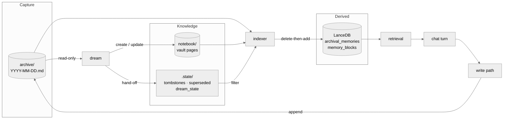
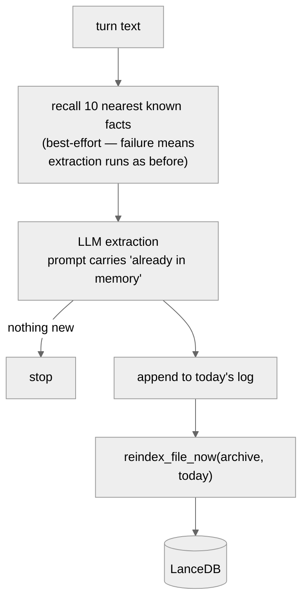
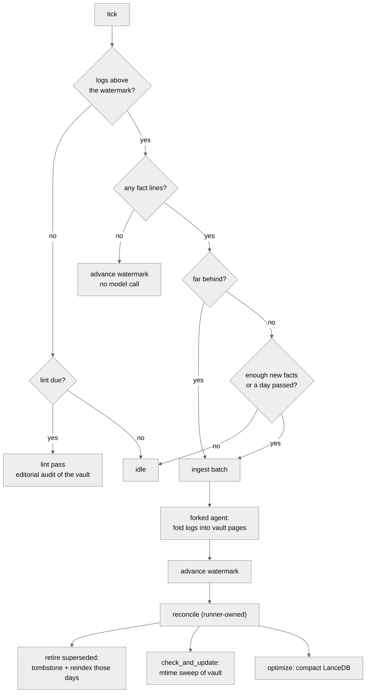

# Memory Architecture

How memory is written, consolidated, indexed, and read.
Companions: [Memory](../../03-features/memory/README.md#how-memory-is-tidied) for how the dream
behaves from the outside, [Memory internals](./memory-internals.md) for the class-by-class reference.

## Three tiers, one job each

| tier | location | job | who writes it |
| --- | --- | --- | --- |
| Capture buffer | `sandbox/shared/memory/archive/YYYY-MM-DD.md` | Lossless and fast. Never reasoned over at write time. | write path, append only |
| Knowledge base | `~/.suzent/notebook/**/*.md` | Consolidated claims with provenance and lifecycle | the dream, via file tools |
| Search index | `~/.suzent/memory` (LanceDB) | Derived. Rebuilt per file, never authored. | the indexer, exclusively |

The direction of travel is one-way: logs feed the vault, both feed the index, and the
index feeds retrieval. Nothing reads back up the chain.

## Write path, in batches of turns

Extraction reads each chat's JSONL transcript (`transcripts/{chat_id}.jsonl`), which
gets one user and one assistant entry per turn. `memory/extraction_queue.py` keeps a
cursor per chat in `transcripts/memory_cursors.json` and extracts the turns past it:

- at the end of a turn, when 6 or more turns or 8k characters are pending;
- otherwise when the chat has been quiet for 10 minutes;
- before the chat's context is compacted, so compacted turns stay recallable;
- on start, for anything still pending when the app last closed.

A batch (at most 16k characters) is the new turns, each dated with when it happened,
after the last two already-extracted turns marked as context only. It goes through
`MemoryManager.process_conversation_for_memories`. The cursor moves only once the batch
is written, and a failed extraction raises, so the turns stay queued and are retried.
The first run after upgrading from per-turn extraction starts every existing chat at
its current end, since those turns were already extracted. Turns from a chat with
memory switched off are skipped rather than queued.

The transcript entry is the user's message with hidden reminders stripped, the tool
calls made this turn with the start of each result, and the final reply. The main
agent's system prompt and reminders are left out on purpose: the reminder carries
recalled memories, and an extractor that saw them would store them again. Tool calls
answered before the turn started are excluded, because the history snapshot spans the
whole chat.

There is deliberately **no write-time deduplication**. A 0.85 cosine threshold used to
sit here and silently dropped *updates* to facts (#34). Repetition is suppressed one step
earlier instead — the extractor is shown what memory already holds and told that a fact
which *changes* a known one must still be emitted.

## Typed capture

`memory_capture_mode` picks the extractor. `legacy` is the untyped one above. `typed`
uses `memory/capture.py`: the model proposes at most `MAX_CANDIDATES` (5) candidates per
batch, each labelled with

- `kind`: `user` (about the person), `experience` (a lesson from how a task went) or
  `world` (a fact read in a file, page or tool result);
- `source`: `user_said`, `user_did`, `outcome`, `agent_said` or `tool_output`;
- `horizon`: `durable`, `dated` or `ephemeral`;
- `evidence`: the exact words behind it.

A deterministic gate then drops what the labels prove is not a memory. Its drop codes:

| code | dropped because |
| --- | --- |
| `agent_said` | the agent's own words are not evidence |
| `ephemeral` | only matters for the current task |
| `user_kind_wrong_source` | a User fact must come from `user_said` / `user_did` |
| `evidence_not_in_user_line` | the evidence is not in any USER line of the new turns (≥0.8 bigram overlap) |
| `tool_output_without_citation` | tool output that is not a World fact, or has no path or URL |
| `outcome_not_experience` | an outcome filed as something other than Experience |
| `experience_channel` | a lesson; only the experience step below proposes those |
| `context_free_choice` | a pick that only makes sense inside the chat ("option 2", "the second one") |
| `rejected` | matches `.state/rejected.jsonl` |
| `restatement` | ≥0.9 similar to a fact already in the recall set |
| `over_cap` | past the per-batch cap |

Kept facts go to the daily log as before, with tags (`kind:` `source:`, `dated
stale_after:<+90 days>`, `ungrounded` when a specific is not in the evidence) and a
`> "evidence"` line under the fact, which the dream reads.

`shadow`, the default, runs both: the legacy extractor still writes, and typed capture
runs on the same batch and appends the legacy facts beside what it would have kept and dropped (with codes) to
`.state/capture_shadow.jsonl` without writing. A shadow failure never fails the batch.
The point is a week of side-by-side evidence before switching to `typed`.

Scheduled turns are filtered per turn in `extraction_queue._is_scheduled`, so a cron or
heartbeat run inside a normal chat is not captured as user facts. `cron` is deliberately
not in `_is_system_chat`: that list also makes a chat stateless.

### Experience capture

The user-fact pass reads USER lines, so it never sees the agent fail and then find what
works. `memory/experience.py` is a second step on every batch, scheduled turns included
(`MemoryManager.process_experience`, called from `ExtractionQueue.flush`):

1. `has_signal` is a regex pre-filter: an error, failed exit code or named root cause in
   an ASSISTANT or ACTION line, or a correction in a USER line. Without one there is no
   model call; on the replay below about half the batches had one.
2. The model returns `Lesson`s: situation, attempt, outcome, lesson, scope, and two
   verbatim quotes, `evidence_fail` and `evidence_fix`. Known durable memories are listed
   so a recurring lesson is proposed in its existing wording.
3. `gate` drops a lesson when either quote is not in one new-turn message (lines of a
   quote may skip lines of that message, but cannot span two messages) or both quote the
   same words (`no_outcome`), when its scope is generic (`no_scope`), when it matches the
   rejected list (`rejected`), or past `MAX_LESSONS` (3, `over_cap`). A lesson whose text
   overlaps a known memory by `REPEAT_MATCH` (0.8 of bigrams) is a repeat: it is appended
   to the confirmations sidecar instead of being written again.
4. Kept lessons go to the daily log tagged `kind:experience source:outcome scope:<slug>`
   with both quotes as the evidence line. In `shadow` mode they only go to
   `capture_shadow.jsonl` with `"channel": "experience"`; `legacy` skips the step.

A failure here is logged and never fails the batch.

A replay of 63 historical batches (2026-10-21 to 23) found a signal in 33 and kept 7
lessons, each tied to a real failure and fix (`gh pr create --repo`, `python -X utf8`, the
CSS-vs-canvas coordinate handedness, the `.releases/changes` declaration, among others).
An expired login and an unresolved push failure produced none. The `.releases/changes`
lesson came back as a repeat of an existing page.

### `memory_update`, the explicit path

`tools/recall/memory_tools.py` gives the main agent one tool for what the user states
directly, routed through `MemoryManager.apply_memory_update`:

- `fact` writes a candidate straight to the daily log, skipping the gate. A `kind=user`
  fact is tagged `source:user_said explicit`; only the user can vouch for one, so other
  kinds are never `explicit`.
- `retract` with `retract_as=wrong` (default) appends to `.state/rejected.jsonl` and
  tombstones matching rows; `outdated` only tombstones, since the claim was true once.
- `fact` and `retract` together are a correction, tagged `revision`.
- `kind=experience` requires `outcome` (it becomes the evidence, `source:outcome`);
  `kind=world` requires `source`, a path or URL (`source:tool_output`). The tool refuses
  either without it.

## The dream

A background loop ticking every `memory_consolidation_interval_seconds`. It has one gate
and two phases.

Ingest is always preferred over lint, so an editorial audit can never starve
consolidation of new logs.

### What the dream is told

The dream is a judgment agent: capture proposes, the dream decides. Its brief
(`memory_context.build_dream_instructions`) routes by tag to a page type —
`kind:user` to a `type: personal` page, `kind:experience` to a `type: experience`
page (merged per situation, keeping its `scope:`; a repo-scoped lesson confirmed 3 or
more times becomes a review-queue proposal to add it to that repo's AGENTS.md),
`kind:world` to a knowledge page with its source;
`dated` never lands on a personal page,
`ungrounded` is filed only as far as its evidence goes, and `explicit` wins over what it
contradicts. Untagged lines from before typed capture must pass the exclusion rules.

For each candidate it picks a case: a duplicate raises the page's frontmatter
`confirmed` count; a correction replaces the claim; a change over time moves the old
value to `## History` as `- until <date>: old`; an unsettled contradiction becomes a
question in `.state/review_queue.md`. Inline `(confirmed Nx, …)` counters are moved
into frontmatter as pages are touched.

Besides the confirmations and revisit queues, the brief carries the rejected list, the
open review questions (not to be asked again; an answered one is applied and deleted),
and the deterministic lint findings from `memory_map.lint_store`. The lint pass gets the
findings too.

The agent records every operation in `.state/dream_ops.md` (`- update`, `- create`,
`- retire`, `- skip <candidate>: <reason>`). After a good ingest or lint the runner
appends it to `log.md` under the run's entry and clears it (`flush_dream_ops`); the
agent itself never writes `log.md`.

Up to `OPEN_QUESTIONS_SHOWN` (5) review questions are rendered into the core memory
prompt under "Open memory questions", for the main agent to ask when natural and answer
through `memory_update`. `review_queue.md` is part of `core_memory_revision`, so an
answered question invalidates the cached prompt.

The trigger: days with no fact lines advance the watermark without a model call;
otherwise a run starts on `memory_consolidation_min_facts` (20) or once
`memory_consolidation_min_hours` (24) have passed, whichever comes first. A batch that
already failed waits out the hours rather than retrying on volume.

### Why the reconcile belongs to the runner

The agent's only declared capability is writing files. It hands the runner a list of log
facts it has folded into pages, in `notebook/.state/superseded.txt`; the runner
tombstones each line, reindexes each affected day, and truncates the file last so a crash
replays rather than loses.

The explicit reindex is not a belt-and-braces measure. **Appending a tombstone does not
change the log's mtime**, so the watcher — which triggers on mtime — would never revisit
those days on its own.

## Invariants worth not breaking

1. **Daily logs are append-only.** Never rewritten, so nothing races the live write path
   appending to today's file.
2. **The indexer is the only writer to LanceDB.** Every other component asks it.
3. **The indexer is not append-only.** Only the markdown history is. `_reindex_file` is
   delete-then-add per file, which is what makes reindexing idempotent and safe to repeat.
4. **Tombstones are the only removal mechanism.** History stays intact; the derived row
   disappears. Every tombstone write must be paired with an explicit reindex.
5. **Recall enrichment must never block a write.** A search outage degrades extraction
   quality, never durability.
5b. **The write path may recognise a repeat, never an update.** The one case it is
   allowed to divert is a word-for-word restatement of a claim already recorded in an
   append-only store, adding no new specifics. Anything else — a new detail, a
   contradiction, a match found only in a transcript — is written exactly as before.
   Issue #34 was this line being crossed.
6. **Nothing regenerates `MEMORY.md`.** It is a curated map; code only drafts it when
   the file is missing or empty, and an existing file is never overwritten.

### MEMORY.md is a map

`MEMORY.md` is injected into every prompt, so it holds pointers, not facts: one
`[[page]]` line each with a short description, at most `memory_map_max_lines` (30).
`MemoryManager.ensure_memory_map` drafts it from page titles (`memory_map.draft_map`)
only when the file is missing or empty. After that the dream keeps its links current
and a person may edit it; the old per-turn `refresh_core_memory_facts`,
`promote_memory_md` and the generated/manual zones are gone.

`memory_map.lint_store` checks the always-injected files without a model:

- `MEMORY.md`: every line one `[[page]]` pointer, no prose facts, within the line cap;
- `user.md`: at most `USER_MD_MAX_LINES` (40), no scheduler specs or repo state, no
  rejected claims;
- `persona.md`: at most `PERSONA_MD_MAX_LINES` (60);
- `heartbeat.md`: no rejected claims;
- notebook pages: at most `PAGE_BUDGET_BYTES` (8 KB), and one `untyped` finding naming
  pages with no frontmatter `type:`.

Code never assumes a folder layout. Personal pages are found by `type: personal`
(`memory_map.PERSONAL_TYPE`), so a user who renamed or renumbered folders loses nothing.
Where each type lives is decided by the notebook skill's `skills/notebook/memory.md`:
`schema.md` first, then where pages of that type already are, then the closest existing
folder, never a new numbered top-level folder and never an edit to `schema.md`. The dream
loads no skills, so `memory_context.filing_reference()` inlines that file into the dream
and lint system prompts; agents that load the skill read the same file. Code never parses
placement. `wiki_manager`'s numbered zones are only the seed for a new vault.

`suzent memory lint` prints these findings. `suzent memory cleanup`
(`memory/cleanup.py`) writes the one-time migration as drafts only, into the vault's
`.state/cleanup/<date>/`: a map draft, `user.md` cut to its contract, page drafts without
what `user.md` owns, a `rewrite_brief.md` of moved lines and flagged pages, a
rejected-list seed and a `migration.diff`. Nothing live is changed; a person applies it.

### Always resolve the vault path

The configured `notebook_dir` and the vault the dream actually writes to are not always the
same directory — a vault mounted at `/mnt/notebook` leaves a stale bootstrap skeleton at
the configured path. Anything inspecting or measuring the vault must go through
`resolve_notebook_dir()`, or it reports on the wrong tree.
## Borrowed from the Open Knowledge Format

[OKF v0.2](https://github.com/GoogleCloudPlatform/open-knowledge-format/blob/main/SPEC.md)
frontmatter is per-document, so it maps onto vault pages — which previously carried no
frontmatter at all — and not onto individual log fact lines. Daily logs stay dumb.
Producer-defined keys are explicitly permitted, so partial adoption is within its rules.

- `status: draft | stable | deprecated` — `deprecated` is a softer tombstone: the claim
  stays readable and linkable but leaves retrieval ranking, and it is reversible.
- `stale_after` — an absolute instant that gives the dream a revisit queue. Defaults are
  derived from the fact `category` rather than guessed per fact by the extractor: identity
  effectively never, `preference` a year, `technical` six months, `goal` three months,
  `context` three weeks.
- `verified: [{by, at}]` — with OKF's actor convention, so a user editing a core memory
  block is a `human:` verification that outranks anything the extractor produced. This also
  supplies the contradiction-resolution rule the system otherwise lacks.
- `generated: {by, at}` — uniform provenance across logs, vault, and core files.
- `sources[].usage_count` — the most useful borrowing. A fact extracted 64 times is not 64
  facts; it is one claim confirmed 64 times, so collapsing repeats into a counter turns the
  worst noise source into a ranking signal. It is the page's frontmatter `confirmed`
  count; older pages carry it inline on the bullet (`(confirmed 12x, last 2026-08-20)`)
  and the dream moves it up as it touches them. Ranking takes the larger of the two, so
  a page mid-migration ranks the same, and a missing count means confirmed once. A repeat that *contradicts* the bullet is explicitly not a
  confirmation — it resets the count and takes the correction path.

Not adopted: the Attested Computation family (`runtime`, `parameters`, `computation`,
`executor`, `attester`), `resource` URIs (the vault already uses `[[wikilinks]]`), and
formal `okf_version` conformance.

These rules live in `DREAM_INSTRUCTIONS` as well as in `schema_example.md`, because
`schema.md` is copied into a vault once at bootstrap and is user-editable afterwards —
every vault predating them keeps its own copy.

## Claim lifecycle and ranking

The lifecycle fields the dream writes are read back by retrieval. A vault chunk's indexed
`importance` is derived from its confirmation count (log-scaled, capped at +0.25), its
`status` (`deprecated` drops it to 0.1, `draft` −0.05), and its `stale_after` (×0.6 once
passed). Daily-log facts keep the neutral 0.5 — raw capture has no lifecycle.

A page whose frontmatter carries `verified_by: human:<name>` is the one claim in the
system that did not come from extraction: it is the claim's subject stating it directly.
Retrieval reads that stamp as an importance *floor* (`HUMAN_VERIFIED_FLOOR`, 0.9) rather than a bonus, so a low
base score cannot dilute it. It also skips the `stale_after` decay — an expiry means
nobody has re-confirmed the claim lately, which is exactly the question a human
verification answers. `deprecated` still wins, because a person retiring a claim is also a
person, and only a `human:` actor qualifies, or an agent would launder its own output into
the strongest evidence class there is.

## Classifying a restatement

`memory/classifier.py` compares each extracted fact against the recall set already
assembled for the extraction prompt, so it costs no extra retrieval and no extra model
call. The comparison is lexical on purpose — the only band that changes behaviour is
"practically the same sentence", which is what a lexical measure is good at and what a
semantic one is too generous about.

Three outcomes:

| outcome | test | effect |
| --- | --- | --- |
| confirmation | ≥0.97 similar, no new specifics, matched against a *durable* source | not written to the daily log; a line in `.state/confirmations.jsonl` that the dream folds into the page's `confirmed` count |
| revision | similar, or a strict superset carrying a new specific | written exactly as before, tagged `revision` |
| new | everything else | written as before |

Two guards do the real work. A match found only in a chat transcript or in the generated
`MEMORY.md` can never divert a write, because neither is a record the write path can defer
to. And any new number, date, quote, path, or version in the restatement makes it a
revision however similar the surrounding prose — `moved to Berlin in 2024` is not a repeat
of `moved to Berlin`.

The confirmations sidecar is truncated only by the number of lines the agent was actually
shown, since conversations keep appending to it while the dream runs.

## The revisit queue

A deterministic frontmatter scan by the runner, handed to the dream alongside the
confirmations: vault pages past their `stale_after`, soonest first, to be re-confirmed
against the logs being ingested — never deleted. Both queues are runner-owned for the same
reason the watermark is: index and lifecycle mutation stays out of the agent's hands.

A `type: personal` page with no `stale_after` *at all* is queued too, after every genuinely
expired one. Selecting strictly on the field would mean pages written before the field
existed are never queued, so the dream never visits them, so the field is never written —
the pages most in need of a first pass would be the only ones permanently exempt from one.
Letting the dream backfill the field beats a script guessing it, because a wrong
`stale_after` actively damps a good claim in the ranking above, and only the dream can see
which category a claim belongs to. The undated branch is scoped to personal pages: a wiki
or project page having no expiry is correct, not a backlog item.

## Testing a mutating pass

`scripts/dream_dry_run.py` clones `~/.suzent`, redirects the `/mnt/notebook` volume at a
copy of the vault, and drives the real `DreamRunner` over the clone, leaving a unified diff
to review. The redirect is the point — the vault is a host path mounted into the sandbox,
*not* a directory inside the data dir, so cloning `~/.suzent` alone isolates everything
except the one thing the dream rewrites. Exercise the lint pass against a clone before
letting it run over a real vault.

One outstanding one-time cleanup — retiring pre-June index rows that predate the markdown
tier — is described in
[Upgrading](../../01-getting-started/updating.md).
