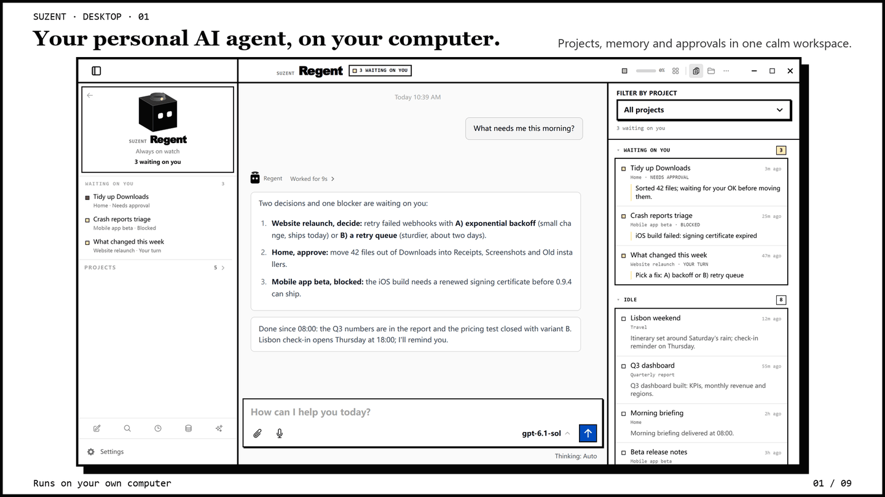
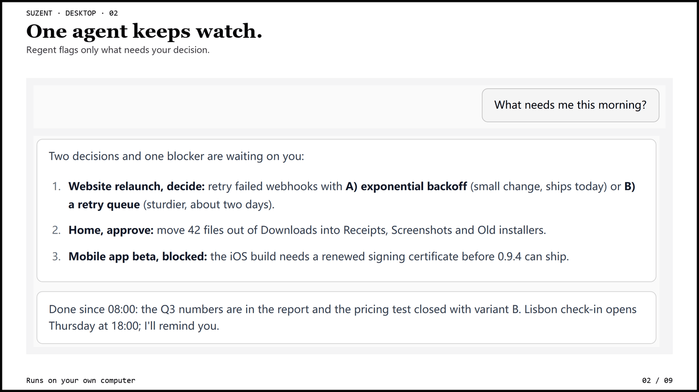
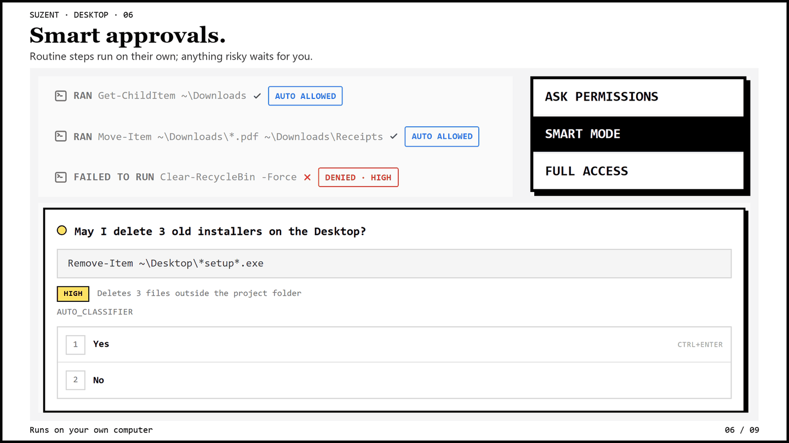

Suzent's Windows app is now on the **Microsoft Store**. Click **Get** and it
installs: no PowerShell, no Git, no Python setup. It is the same agent as
before, with the same memory, the same 16 model providers, and the same
permission modes, in a package Windows manages for you.

<!-- truncate -->

## How to get it

Open the [Store listing](https://apps.microsoft.com/detail/9MZQ1HHXHVZT?mode=full),
click **Get**, and launch Suzent from the Start menu. Add a model under
**Settings → Providers** (or pick Ollama to stay fully local) and start
chatting. The [Quickstart](https://suzent.com/docs/getting-started/quickstart)
covers the rest.

The Store is now the recommended way to install on Windows. The desktop
installer and the terminal script still work and are not going away.

## What's different about the Store build

- **Everything is bundled.** The package carries its own Python runtime,
  Suzent and its dependencies, so the first launch does not download or build
  anything.
- **Sandboxed package identity.** Windows installs it as a signed MSIX package
  and keeps the install folder read-only. Your chats, memory, settings and keys
  stay in `~/.suzent`, so they survive reinstalls and uninstalls.
- **Updates come from the Store.** Updates arrive through the Store like any
  other app. `suzent update`, `upgrade` and `repair` are turned off in this
  build because Windows owns the install.
- **Start at login, the Windows way.** Settings → Background service turns on
  the package's startup task. It is off by default, and you can also manage it
  in Windows Settings → Apps → Startup.

Nothing about how the agent behaves changes. Regent still runs your projects
in the background and only comes back to you when a decision is yours. Risky
actions still wait for your approval, under the rules you set.

**Already using the installer version?** You can install the Store app next to
it, and both use the same `~/.suzent`. Run one at a time: quit the other one,
including its background service, first.

## What's coming

Store releases will follow the desktop release train: each tagged desktop
release is submitted to the Store from CI, so the Store version keeps up with
GitHub. Certification by Microsoft still applies, so expect a short delay after
each release.

---

[Get it from the Microsoft Store](https://apps.microsoft.com/detail/9MZQ1HHXHVZT?mode=full) ·
[Quickstart](https://suzent.com/docs/getting-started/quickstart) ·
[Source](https://github.com/cyzus/suzent) (Apache-2.0)
