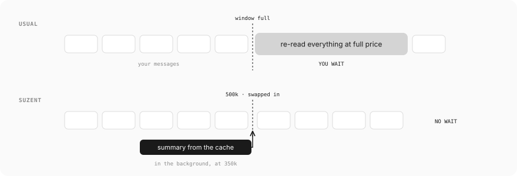
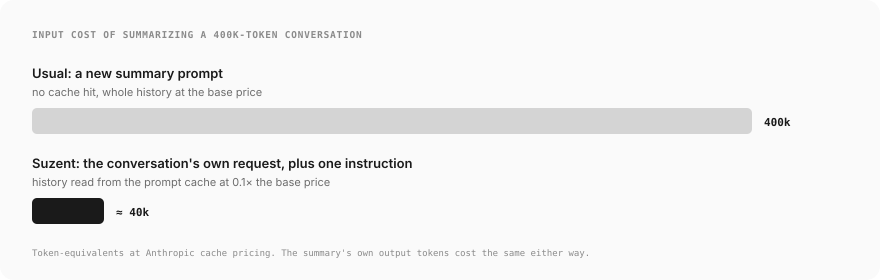
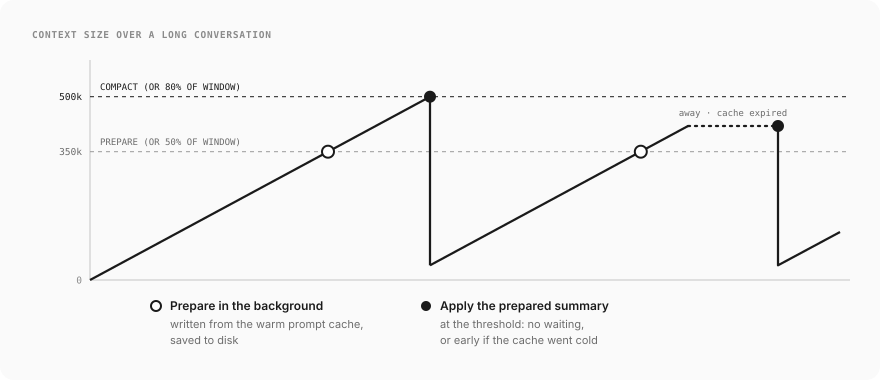

Every agent that runs long enough meets the same wall. The conversation keeps
growing, the model's context window does not, and at some point older messages
have to be folded into a summary so the work can go on. This is called
**compaction**, and nearly every agent harness does it the same way: wait until
the window is almost full, stop, send the whole history to a model with "please
summarize this", and swap the result in.

That approach has three costs that are easy to miss:

1. **You wait.** Summarizing several hundred thousand tokens takes a while, and
   it happens right when you send your next message.
2. **You pay full price to re-read everything.** The summary request is a new,
   different prompt, so the provider's prompt cache does not apply. The entire
   history is billed again as fresh input.
3. **You lose detail.** A summary is lossy by design. Compact too early and the
   agent forgets things it still needed. Compact too late and it was already
   struggling to use them.

This month we rebuilt Suzent's compaction around those three
costs. Here is what changed and why.

<!-- truncate -->

## Write the summary from the cache

Providers like Anthropic, OpenAI, Gemini and DeepSeek cache the beginning of a
prompt they have seen recently. If your next request starts with exactly the
same tokens, that part is read from the cache at a fraction of the normal input
price. On Anthropic, for example, a cache read costs a tenth of the base price.
A long agent conversation is almost entirely cache hits, because each request
is the previous one plus a little more.

The usual summary request throws that away. It flattens the history into text,
wraps it in a new prompt, and sends it to a model, so nothing matches the cache.

Suzent instead records each conversation's latest request **exactly as it was
sent**: the same system prompt, the same tool definitions, the same messages in
the same order. To write a summary, it sends that request again with one
addition: the instruction to summarize, appended to the last message. To the
provider, this looks like the conversation's next turn. The whole history is
read from the cache, and only the instruction and the summary itself are billed
at the full rate.

The difference is large. Summarizing a 400k-token conversation on Anthropic
used to cost 400k input tokens at the base price. Read from the cache, the same
history costs about as much as 40k.

Recording the request "as sent" matters more than it sounds. The framework adds
small pieces to a request on the way out, so the history Suzent stores is not
byte-for-byte what the provider saw, and a single differing byte early on is
enough to miss the cache. When the recorded request no longer covers the
history being folded, Suzent notices and falls back to the old method instead
of writing a summary of the wrong messages.

## Prepare it before you need it

Reading from the cache makes the summary cheap. It does not make it instant.
So Suzent starts writing the next summary **in the background, well before it is
needed**.

Two thresholds do this, each a token count or a share of the model's window,
whichever comes first:

- **Prepare** at 350k tokens or 50% of the window. Suzent writes the summary in
  the background, during a long run or right after a reply finishes, while the
  cache is still warm from the request that just happened.
- **Compact** at 500k tokens or 80% of the window. If a prepared summary
  matches the history, it is applied immediately. You do not wait for anything.

A prepared summary is saved to disk, so restarting Suzent does not throw it
away. If the conversation keeps growing a lot after the summary was written,
Suzent writes a fresh one rather than applying a stale one. As far as we could
find, no other agent harness pre-writes its compaction summary like this.

## Notice when the cache has gone cold

Caches expire. Anthropic keeps one for 5 minutes by default (or an hour, at a
higher write price), OpenAI and Gemini for roughly 5 to 10 minutes of
inactivity, and DeepSeek for hours. No provider tells you how long an entry
will actually live.

That matters for a long conversation you come back to after lunch. If it is
already at 400k tokens and the cache has expired, your next message re-reads
all 400k at full price, even though compaction is not due yet.

Suzent estimates each model's cache lifetime, starting from what the provider
documents and raising the estimate whenever it sees a cache hit after a longer
pause than expected. When you return to a conversation that is past the
"prepare" threshold and the cache has probably gone cold, Suzent applies the
prepared summary **early**. You send a much smaller prompt instead of paying to
rebuild a cache for history that was about to be summarized anyway.

When a summary has to be written on a cold cache, there is no discount to keep,
so Suzent compares the price of the conversation's model with the memory
extraction model and uses whichever is cheaper.

## Why 500k, and not 200k

Our first version compacted at 200k tokens. It was cheaper, but compaction is
lossy, and we were throwing away detail that many models could still use.

On multi-needle recall benchmarks such as MRCR, where a model has to find
several related facts scattered across a long context, the strongest current
models hold up well to around half a million tokens and degrade noticeably after
that. Several others fall off much earlier, near 200k. Past 500k, every message
also pays to send the whole history again, cache or not.

So the default is 500k tokens or 80% of the window, whichever comes first. A
128k model compacts at about 102k, a 200k model at 160k, and a 1M-token model
at 500k. You can change both thresholds, or cap the context budget lower to
keep costs down.

## You can see it happen

A compaction shows up in the chat as a thin divider at the point where it
happened, with the context size before and after. A line under it says whether
the summary was prepared in advance or applied early because the cache had
expired, and **Show summary** opens what the older messages became. The
**Context** panel shows when the conversation was last compacted and whether
the next summary is being prepared or is ready.

None of this is magic, and you should not have to take it on faith. The
summary is right there to read, and if it dropped something that mattered, you
will know.

---

[Context and compaction settings](https://suzent.com/docs/features/memory/configuration) ·
[Configuration reference](https://suzent.com/docs/reference/configuration) ·
[Source](https://github.com/cyzus/suzent) (Apache-2.0)
