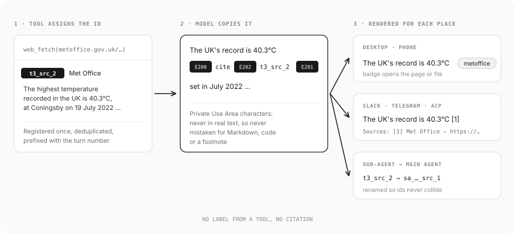
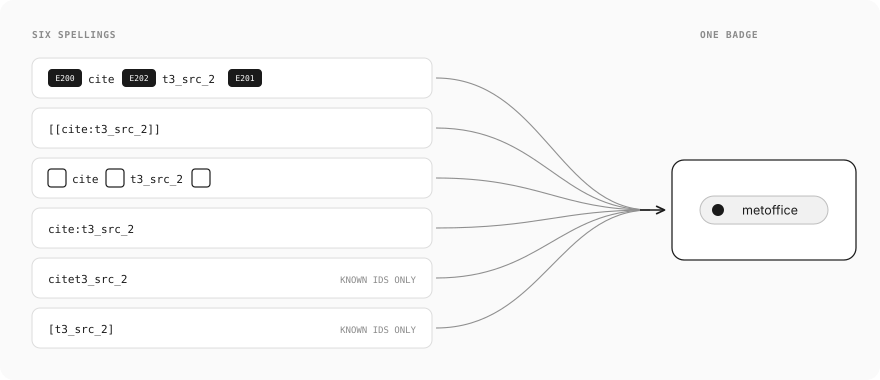
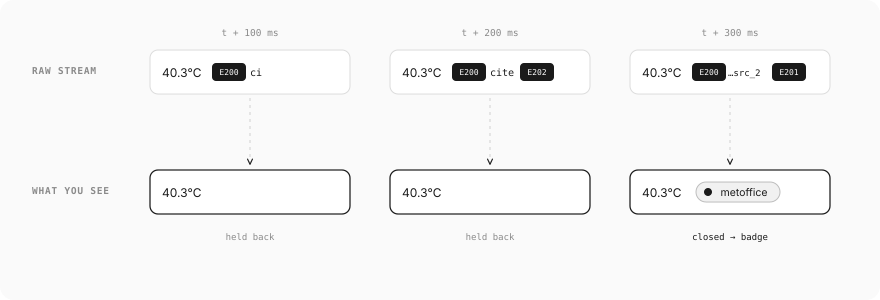

An agent that reads the web and your files for you is only as useful as your
ability to check it. "The record is 40.3°C" is a claim. "The record is 40.3°C",
with a small badge that opens the Met Office page it came from, is something
you can verify in one click.

Suzent puts those badges inline, next to the sentence they support, in the
desktop app, on your phone and in sub-agent reports. When the answer goes to
Telegram or Slack instead, they turn into numbered references with a source
list. This post is about how that works, and why the markers underneath are
made of characters you are never meant to see.

<!-- truncate -->

## Ids come from the tools, not the model

The easiest way to get bad citations is to let the model make them up. Ask a
model to "cite your sources" and it will happily produce plausible URLs,
footnote numbers that point nowhere, or a tidy list of sources at the end that
it never actually read.

So in Suzent the model never chooses what a source is. Every tool that brings
in citable material, such as web search, page fetches, file reads, memory,
browser pages and sub-agents, registers each source as it reads it and gets an
id back, like `t3_src_2`: the second source of the conversation's fourth turn.
The tool prints that id right next to the evidence:

```
[t3_src_2] Met Office: UK climate extremes
The highest temperature recorded in the UK is 40.3°C, at Coningsby on 19 July 2022 …
```

The model's job is narrow: when it states something from that result, it
copies the id. If a tool result carries no label, the rules say not to cite it,
and the same goes for the model's own reasoning or general knowledge. A badge
in Suzent means "a tool really fetched this", never "the model felt like
adding a reference".

A few details make this hold up over a long conversation:

- **Ids carry the turn number**, so a reply that cites something read three
  turns ago still resolves to the right page instead of colliding with this
  turn's first source.
- **The same page gets the same id.** Reading a page twice reuses its id, so
  you don't get two badges for one source.
- **The source list is not in the prompt.** Only the fixed citation rules are.
  The ids travel inside tool results, which are already part of the
  conversation, so the system prompt never changes between turns and stays in
  the provider's prompt cache. (That matters for cost. See
  [how Suzent compacts context](/blog/compaction-without-the-wait).)

## Why invisible characters

The model then needs a way to write "this sentence comes from `t3_src_2`" in
the middle of its prose. The obvious options all collide with something:

- `[1]` is ordinary Markdown and ordinary text. Papers, code and legal
  documents use it constantly.
- `[[t3_src_2]]` looks like a wiki link, and Suzent's own memory notes are
  Markdown that might contain exactly that.
- HTML tags or footnote syntax get mangled or rendered by the Markdown
  pipeline before the citation parser ever sees them.

Unicode has a block made for exactly this situation: the **Private Use Area**,
code points that no standard assigns any meaning to and that never appear in
normal text. Suzent's marker is three of them wrapped around a type and a
payload:

```
U+E200  cite  U+E202  t3_src_2  U+E201
```

This is the same style of marker that ChatGPT's own answers use. Because these
characters never occur in real writing, a match can't be a false positive. The
marker can't be confused with Markdown, code, a wiki link or a footnote in a
document the agent is quoting. Several sources go in one marker
(`t3_src_2`, `t3_src_4`, separated by another `U+E202`), and the type keyword
leaves room for other inline objects later without a new parser.

The system prompt shows the model the exact characters to copy, and the
renderer turns each marker into a badge.



## Models are messy, so the parser forgives

That is the theory. In practice, models copy unusual characters imperfectly,
and the text passes through browsers and Markdown renderers that have opinions
about characters they don't recognise. Over time Suzent has learned to read six
spellings of the same citation:

| What arrives | Where it comes from |
| --- | --- |
| `U+E200 cite U+E202 t3_src_2 U+E201` | the intended form |
| `[[cite:t3_src_2]]` | an ASCII form, handy for debugging and older output |
| `U+FFFC cite U+FFFC t3_src_2 U+FFFC` | some browser and Markdown paths swap private characters for the object replacement box |
| `cite:t3_src_2` | the model kept the words but dropped the special characters |
| `citet3_src_2` | the same, with no separator at all |
| `[t3_src_2]` | the model copied the tool's label instead of writing a marker |

The last two look a lot like ordinary text, so they only count when **every id
in them belongs to a real source** in that conversation. A sentence that
happens to contain `[x_src_1]` stays a sentence.



All six render as the same badge. When a marker names an id that isn't in the
current list, for example a source from an earlier part of the conversation,
you get a muted badge instead of a broken one. When an answer has no sources at
all, stray markers are removed rather than shown as boxes.

## Streaming without flicker

Replies stream in a few characters at a time, so for a moment the screen holds
half a marker: `U+E200 cite U+E202 t3_sr`. Shown as is, that is a row of
tofu boxes that flicker into a badge a moment later.

Both the desktop renderer and the backend hide a marker that has started but
not closed, and show it only once it is complete. The markers that have no
closing character at all, such as `cite:t3_src_2`, are held back until the
next bit of text shows where they end.



## Leaving the app

Private Use Area characters are a good format between the model and Suzent's
own renderer. They are a bad format anywhere else. Sent to Telegram, they show
up as empty boxes. Pasted into an email, they mean nothing.

So whenever an answer leaves for a surface that can't draw badges, such as
Slack, Telegram, Discord, a message the agent sends on your behalf or an
editor connected over ACP, Suzent rewrites citations into something portable:

```
The UK's record is 40.3°C [1], set in July 2022 [1].

Sources:
[1] Met Office: UK climate extremes — https://www.metoffice.gov.uk/…
```

This also works while streaming. Text is converted as it arrives, the source
list comes at the end, and as a last safety net any stray private character
is stripped before it can reach an outside app.

Two smaller boundaries get the same care:

- **Sub-agents.** When a sub-agent researches something and reports back, its
  sources come along, renamed with a prefix of their own (`sa_…_src_1`) so
  they can't collide with the main agent's own `t3_src_1`. The main agent can cite the sub-agent's
  evidence directly, and the badge still opens the original page.
- **Truncation.** When a long result has to be shortened, the cut never lands
  in the middle of a marker.

## Your own files count too

Sources aren't only web pages. When the agent reads a file in your workspace,
that file is a source. Its badge shows the file name with an icon for the file
type, and clicking it opens the file on your computer. An answer about your
project can point at the exact `README.md` or PDF it used, the same way an
answer about the news points at a web page.

## What citations don't promise

A badge says that a tool really fetched this source and that the model tied
this sentence to it. It does not prove the sentence says exactly what the
source says. Models can still overstate or misread. What citations change is
how much work it is to catch that: one click, at the sentence where it
happened.

---

[Web and sources](https://suzent.com/docs/features/tools/web) ·
[Source](https://github.com/cyzus/suzent) (Apache-2.0)
