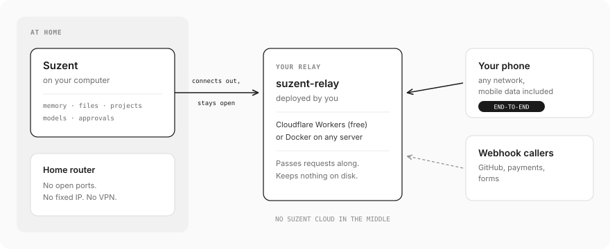
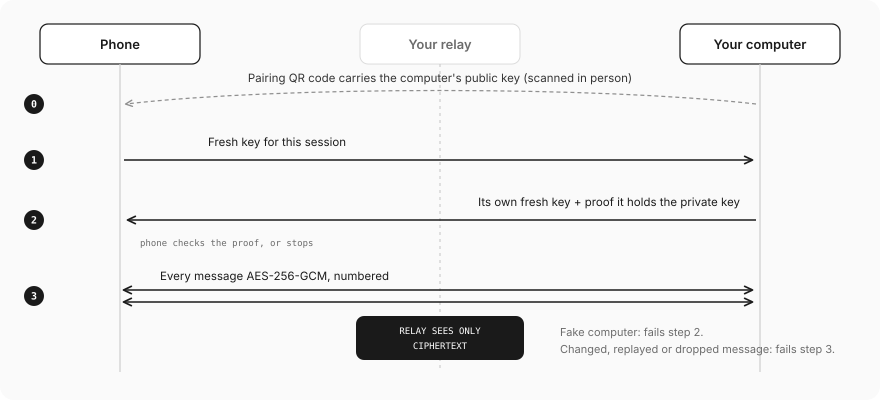

A personal agent that lives on your own computer has one obvious weakness: you
are not always at your computer. You are on the train, at a café, or on mobile
data, and the agent with your memory, your files and your projects is sitting
at home behind a router that will not let anyone in.

Most products solve this by putting the agent in their cloud. Then the question
of reaching it disappears, along with the question of who owns it.

Suzent now solves it differently. Your phone can reach the agent on your
computer from any network, with no VPN, no port forwarding and no fixed IP
address, **through a relay that you deploy yourself**. We do not run one. There
is no Suzent server your conversations pass through, now or later.

<!-- truncate -->

## The usual options, and what each one costs

Getting from a phone on mobile data to a computer behind a home router is an
old problem with a few standard answers:

- **Port forwarding.** Open a port on your router and point it at your
  computer. It works, but it puts a service on the public internet, many
  mobile and home networks block or share addresses so it fails anyway, and
  most people should not be configuring their router for an AI app.
- **A private network such as Tailscale.** A very good option, and Suzent has
  supported it for a while. It does need the VPN app on every device and an
  account with the network provider, and it only helps devices you have added.
  A service like GitHub cannot call into it.
- **The vendor's relay.** The easy path most apps take: the desktop and the
  phone both connect to the company's server, which passes messages between
  them. It just works, and it means a third party sits in the middle of every
  conversation you have with your agent, can see when you use it, and can
  switch it off.

The third option is the one we did not want. Suzent's whole point is that the
agent is yours: its memory is Markdown on your disk, its model is your choice,
and its runtime is on your hardware. Routing every message through a server
we operate would quietly undo that.

So we kept the convenience of a relay and changed who runs it.

## How it works

[suzent-relay](https://github.com/cyzus/suzent-relay) is a small open-source
server. You deploy it once, either for free on Cloudflare Workers with no
server to look after, or with Docker on any machine you already have.

Suzent on your computer connects **out** to your relay and keeps that
connection open. Because the connection goes outwards, nothing on your router
has to change. When your phone sends a request to the relay, the relay passes
it down that open connection, Suzent answers, and the answer travels back the
same way. Ordinary requests, streamed replies and live connections all work,
so chatting from your phone feels the same as at home. The relay keeps nothing
on disk.

The relay is a fork of [alma-relay](https://github.com/yetone/alma-relay) by
yetone, an MIT-licensed relay with exactly the shape we wanted. Suzent adds
its own encryption on top, described next.

## The relay cannot read your conversations

A relay you deploy yourself is already much better than one run by a company.
But a relay still runs on someone's infrastructure, such as a Cloudflare
account or a rented server, so we did not want its safety to depend on that.

Phone traffic is **end-to-end encrypted**, and the relay only passes on bytes
it cannot read or change:

1. When you pair your phone, the QR code carries your computer's public key.
   The phone now knows exactly which machine it should be talking to.
2. Each time the phone connects through the relay, it runs a short handshake
   against that key (in the style of the Noise NK pattern, on P-256). Your
   computer has to prove it holds the matching private key before the phone
   sends anything.
3. Both sides derive fresh keys for that session, and every message is
   encrypted with AES-256-GCM and numbered. A message that is replayed,
   dropped or reordered fails to decrypt, and the session ends.

A relay that tries to pretend to be your computer fails step 2. A relay that
tries to tamper with a message fails step 3. The most it can do is refuse to
pass traffic along, which you would notice.

Two more rules keep the exposed surface small:

- **Only the phone channel and webhooks get through.** Everything else in
  Suzent stays closed to the internet, relay or not. Requests that arrive
  through the relay are treated as remote callers, never as local ones.
- **The phone tries your direct addresses first.** At home on Wi-Fi, or over
  Tailscale if you use it, the phone talks to your computer directly. The
  relay is only used when nothing closer answers.

## It also gives your webhooks an address

Suzent can run a task when a webhook arrives: a new GitHub issue, a payment
event, a form submission. Those services need a public URL to call, which a
computer at home does not have.

Once the relay is connected, every webhook task gets a second URL that goes
through the relay. Give that one to GitHub and your agent picks up events
wherever your computer happens to be. One honest caveat: the relay can read
webhook payloads in transit, just as any webhook receiver can. That is one
more reason for the relay to be yours.

## Setting it up

1. Deploy suzent-relay by following its
   [README](https://github.com/cyzus/suzent-relay#deploy). Cloudflare Workers
   takes a few minutes and costs nothing for one person's traffic. Set a
   registration key so only your Suzent can use it.
2. In Suzent, open **Settings → Devices → Relay**, enter the relay address and
   registration key, and save. The status turns to **Connected**.
3. Turn on the background service, so Suzent stays connected after you close
   the desktop app.
4. Pair your phone by scanning a new QR code, which now includes the relay. A
   phone you paired earlier picks up the relay the next time it reaches your
   computer directly, for example on your home Wi-Fi.

That is the whole setup. The full guide is in the
[relay documentation](https://suzent.com/docs/features/relay).

## Relay or Tailscale?

Both are fine, and you can use both. The phone tries every address it knows.

Tailscale is a great fit if you already use it: one private network for all
your devices. The relay needs nothing on the phone beyond the Suzent app,
works for anyone you hand a webhook URL to, and is a single small deployment
you control end to end.

What we will not do is offer a third option where the relay is ours. Your
agent should be reachable from anywhere without anyone else being able to
reach it, and the simplest way to keep that true is for the server in the
middle to belong to you.

---

[Relay docs](https://suzent.com/docs/features/relay) ·
[suzent-relay](https://github.com/cyzus/suzent-relay) ·
[Mobile app](https://suzent.com/docs/features/mobile) ·
[Source](https://github.com/cyzus/suzent) (Apache-2.0)
